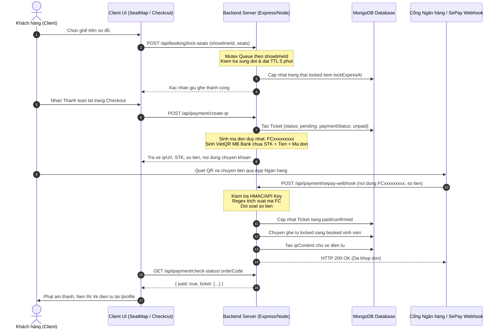

# Luồng Logic Nhiệm Vụ Backend & Thanh Toán VietQR (Tuấn)

Tài liệu này tóm tắt ngắn gọn và chi tiết toàn bộ luồng kiến trúc, xử lý logic và mã nguồn thuộc trách nhiệm của **Tuấn (Backend Core & Database)** trong dự án.

---

## 1. Trách nhiệm và Phạm vi công việc

- **Database & Architecture:** Thiết kế MongoDB Schema (Users, Movies, Theaters, Rooms, Showtimes, Tickets) và cấu hình kết nối Mongoose.
- **Seat Locking Engine:** Thuật toán khóa ghế thời gian thực chống Race Condition bằng Mutex Queue theo từng suất chiếu.
- **Auto VietQR & SePay Webhook:** Tích hợp sinh mã VietQR động, lắng nghe Webhook ngân hàng tự động khớp đơn và xuất vé điện tử.

---

## 2. Sơ đồ Luồng Hoạt Động (Flowchart)

---

## 3. Chi tiết 4 Bước Xử lý Logic

### Bước 1: Khóa ghế thời gian thực (Seat Locking & Concurrency Control)
- **Tập tin liên quan:**
  - `backend/src/services/booking.service.ts`
  - `backend/src/controllers/booking.controller.ts`
- **Logic xử lý:**
  - Khi người dùng bấm giữ ghế, hệ thống đẩy yêu cầu vào hàng đợi đồng bộ (Mutex lock) dựa trên `showtimeId`.
  - Kiểm tra xem có ghế nào đang bị người khác giữ (`locked` còn hạn) hoặc đã bán (`booked`) không.
  - Nếu hợp lệ: Đánh dấu ghế trạng thái `locked`, gán `lockedBy` và thời gian hết hạn `lockExpiresAt = now + 5 phút`.
  - Tránh triệt để lỗi hai người dùng bấm cùng 1 ghế tại cùng 1 phần triệu giây (Race Condition).
  - Kịch bản kiểm thử tải đồng thời: `backend/src/scripts/test-concurrent-seat-locking.ts`.

### Bước 2: Tạo hóa đơn tạm & Sinh mã VietQR động
- **Tập tin liên quan:**
  - `backend/src/services/payment.service.ts`
  - `backend/src/controllers/payment.controller.ts`
- **Logic xử lý:**
  - Tạo bản ghi `Ticket` trong MongoDB với `status: 'pending'` và `paymentStatus: 'unpaid'`.
  - Sinh mã giao dịch duy nhất có tiền tố nhận diện: `FC` + chuỗi số ngẫu nhiên (Ví dụ: `FC418936759`).
  - Sử dụng định dạng Napas247 VietQR tạo URL ảnh QR chứa:
    - Mã ngân hàng MB Bank (`970422` / `MB`).
    - Số tài khoản thụ hưởng.
    - Số tiền chính xác của đơn hàng.
    - Nội dung bắt buộc chứa mã đơn `FC...` để hệ thống tự động nhận diện người chuyển.

### Bước 3: Lắng nghe Webhook SePay & Tự động khớp giao dịch
- **Tập tin liên quan:**
  - `backend/src/controllers/payment.controller.ts`
  - `backend/src/routes/payment.route.ts`
  - `start-project.bat` (Cấu hình tunnel Ngrok chuyển tiếp Webhook vào localhost)
- **Logic xử lý:**
  - Endpoint `POST /api/payment/sepay-webhook` tiếp nhận payload từ SePay khi có biến động số dư.
  - Xác thực bảo mật kiểm tra API Key hoặc Secret HMAC.
  - Dùng biểu thức chính quy (Regex) quét chuỗi nội dung chuyển khoản để lấy mã `FC...`.
  - Tìm vé tương ứng trong MongoDB:
    - Kiểm tra số tiền chuyển thực tế >= giá trị vé `ticket.totalPrice`.
    - Chuyển trạng thái vé: `paymentStatus = 'paid'`, `status = 'confirmed'`.
    - Chuyển toàn bộ các ghế trong vé từ `locked` sang `booked` vĩnh viễn trong `Showtime`.
    - Sinh mã định danh vé `qrContent` phục vụ xuất vé điện tử.

### Bước 4: Đồng bộ trạng thái vé về Frontend
- **Tập tin liên quan:**
  - `client/src/pages/Checkout/Checkout.tsx`
  - `client/src/pages/Profile/index.tsx`
- **Logic xử lý:**
  - Phía Client định kỳ polling hoặc khi người dùng bấm nút "Kiểm tra giao dịch", gọi `GET /api/payment/check-status/:orderCode`.
  - Khi Backend báo `paid: true`, giao diện chuyển sang modal thành công, tự động xóa giỏ hàng và điều hướng sang trang Hồ sơ cá nhân (`/profile`).
  - Hỗ trợ endpoint thử nghiệm `POST /api/payment/simulate-transfer` (nút "Duyệt Bill (Test)") cho môi trường phát triển local không cần giao dịch tiền thật.

---

## 4. Bảng Tổng Hợp API Endpoints

| Phương thức | Đường dẫn API | Mô tả chức năng |
| :--- | :--- | :--- |
| `POST` | `/api/booking/lock-seats` | Khóa tạm thời danh sách ghế trong 5 phút kèm Mutex |
| `POST` | `/api/booking/release-seats` | Hủy giữ ghế thủ công khi thoát hoặc hết giờ |
| `GET` | `/api/booking/showtime/:showtimeId/seats` | Lấy danh sách ghế thời gian thực theo suất chiếu |
| `POST` | `/api/payment/create-qr` | Khởi tạo đơn pending và sinh mã QR thanh toán VietQR |
| `POST` | `/api/payment/sepay-webhook` | Webhook nhận biến động số dư SePay và khớp đơn tự động |
| `GET` | `/api/payment/check-status/:orderCode` | Kiểm tra tình trạng thanh toán của mã giao dịch |
| `POST` | `/api/payment/simulate-transfer` | Mô phỏng thanh toán thành công trong môi trường kiểm thử |
